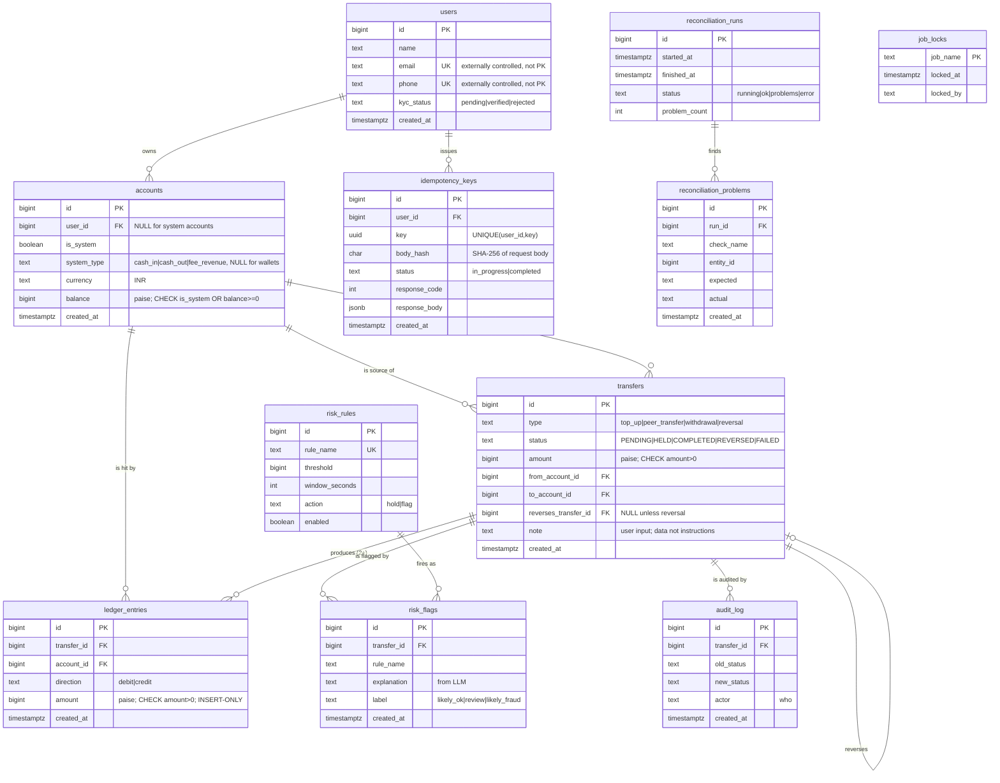

# Wallet Ledger — Schema Design

> Companion to `docs/design.md`. This document derives the relational schema from the requirements:
> a **noun list** (every noun, and why it did or did not become a table), **cardinality decisions**
> (1:1 / 1:M / M:N and where each FK lives), the **constraints and enforcement mechanisms**, and an
> **ER diagram** (Mermaid `erDiagram`). The tech stack is PostgreSQL 15+ with raw SQL (no ORM).

---

## 1. Noun List

Every noun pulled from the requirements, and the modeling decision for each.

| Noun | Table? | Decision & rationale |
| --- | --- | --- |
| **User** | ✅ `users` | A person. System-generated `BIGINT` PK (`id`). `name`, `email`, `phone`, `kyc_status`. |
| **Email** | ❌ column | Externally controlled data on `users.email`. **Not a PK** (can change, is user-supplied, not system-owned). `UNIQUE` for lookup, but surrogate `id` is the key. |
| **Phone** | ❌ column | Same reasoning as email — externally controlled, `UNIQUE` column, never a PK. |
| **KYC status** | ❌ column (enum) | A small, fixed state on `users` (`pending`/`verified`/`rejected`). An enum/CHECK, not its own table. |
| **Account** | ✅ `accounts` | The ledger participant. Holds **both** user wallets and system accounts (see §3). `is_system` flag distinguishes them. |
| **Wallet** | ❌ rows in `accounts` | A wallet **is** a user account (`is_system=false`, `user_id` set). Not a separate table — a wallet and a system account are the same kind of ledger participant and must be interchangeable as transfer endpoints and in reconciliation. |
| **System account** (cash-in, cash-out, fee revenue) | ❌ rows in `accounts` | `is_system=true`, `user_id` NULL, distinguished by `system_type`. Sharing one table lets every transfer and every ledger entry reference a single `account_id` space (see §3 justification). |
| **Currency** | ❌ column | `accounts.currency` fixed to `INR`. One currency per wallet; a CHECK enforces `INR`. A currencies table is unnecessary for a single-currency system. |
| **Balance** | ❌ column (+computed) | `accounts.balance BIGINT` stored (updated inside the locked transfer txn) **and** independently recomputed from `ledger_entries` during reconciliation. See `design.md` §7 for the store-and-compute decision. |
| **Transfer** | ✅ `transfers` | A money-movement intent/record. `type`, `status`, `amount` (paise `BIGINT`), `created_at`, optional `note`, self-reference `reverses_transfer_id`. |
| **Transfer type** | ❌ column (enum) | `top_up`, `peer_transfer`, `withdrawal`, `reversal` as a CHECK/enum on `transfers.type`. **There is no `fee` transfer type** — a fee is not its own transfer (see §8 and finding 1 resolution). |
| **Transfer status** | ❌ column (enum) | `PENDING`, `HELD`, `COMPLETED`, `REVERSED`, `FAILED` as a CHECK/enum. Status changes are audited. |
| **Reversal** | ❌ self-FK | A reversal is a `transfers` row with `type='reversal'` and `reverses_transfer_id` → the original. Not a separate table. |
| **Ledger entry** | ✅ `ledger_entries` | A single debit or credit on exactly one account. A transfer writes 2+ entries; per-transfer debits == credits. Insert-only. |
| **Debit / Credit** | ❌ column (direction) | `ledger_entries.direction` enum (`debit`/`credit`) + positive `amount` (direction+positive chosen over signed; see `design.md` §7). |
| **Idempotency key** | ✅ `idempotency_keys` | `(user_id, key)` unique; SHA-256 `body_hash`; `status`; saved response `code` + `body`. |
| **Reconciliation run** | ✅ `reconciliation_runs` | One row per run: `started_at`, `finished_at`, `status`, per-check counts. |
| **Reconciliation problem** | ✅ `reconciliation_problems` | One row per problem: `run_id`, `check_name`, `entity_id`, `expected`, `actual`. |
| **Job lock** | ✅ `job_locks` | One row per job (`job_name` PK); locked via `SELECT ... FOR UPDATE NOWAIT` for single-run. |
| **Risk rule** | ✅ `risk_rules` | Thresholds live in the DB, not code: `rule_name`, `threshold`, `window_seconds`, `action` (`hold`/`flag`), `enabled`. |
| **Risk flag** | ✅ `risk_flags` | A flag raised on a transfer: `transfer_id`, `rule_name`, LLM `explanation`, `label` (`likely_ok`/`review`/`likely_fraud`), `created_at`. |
| **Audit log** | ✅ `audit_log` | Every transfer status change: `transfer_id`, `old_status`, `new_status`, `actor`, `created_at`. |
| **Statement** | ❌ query | A statement is a **read** over `transfers`/`ledger_entries` for a wallet ordered by time — not stored. |
| **Note** | ❌ column | `transfers.note` free text, treated strictly as **data** (never instructions) when shown to the LLM. |
| **Fee / fee revenue** | ❌ extra entries on the peer transfer | A fee is **two additional ledger entries attached to the originating `peer_transfer` row** (a `debit` on the sender, a `credit` to `fee_revenue`) — **not** a separate transfer. The `peer_transfer` therefore has 4 entries when a fee applies: `SUM(debit)=SUM(credit)=amount+fee`. There is no `fee` transfer type. |
| **Counterparty** | ❌ derived | Resolved at query time from the caller's own transfer history; not a stored entity. |
| **Config (fee amount)** | ✅ `config` | A tiny key/value table (`key TEXT PK`, `value TEXT`) for flat operational settings that are not fraud rules. Holds `fee_paise` (default `0`). Keeps the fee out of `risk_rules`, whose rows all require a `hold`/`flag` action that a fee has no meaning for (finding 11). |

---

## 2. Tables & Key Columns

> Illustrative column lists for the data model. Exact DDL lives in the ordered `migrations/*.sql` files.

- **users** (`id BIGINT GENERATED ALWAYS AS IDENTITY PK`, `name`, `email UNIQUE`, `phone UNIQUE`,
  `kyc_status` CHECK, `created_at`).
- **accounts** (`id BIGINT IDENTITY PK`, `user_id BIGINT NULL FK→users`, `is_system BOOLEAN`,
  `system_type` NULL CHECK∈(`cash_in`,`cash_out`,`fee_revenue`), `currency` CHECK=`INR`,
  `balance BIGINT NOT NULL DEFAULT 0`, `created_at`).
  Invariants: `CHECK ((is_system AND user_id IS NULL AND system_type IS NOT NULL) OR (NOT is_system AND user_id IS NOT NULL AND system_type IS NULL))`;
  `CHECK (is_system OR balance >= 0)` — user wallets never negative, system accounts may be.
- **transfers** (`id BIGINT IDENTITY PK`, `type` CHECK, `status` CHECK, `amount BIGINT CHECK(amount>0)`,
  `from_account_id BIGINT NOT NULL FK→accounts`, `to_account_id BIGINT NOT NULL FK→accounts`, `note TEXT NULL`,
  `reverses_transfer_id BIGINT NULL FK→transfers(id)`, `created_at`).
  **Both account FKs are `NOT NULL`** (finding 6): every flow has a concrete account on both sides —
  top-up is `cash_in → wallet`, withdrawal is `wallet → cash_out`, peer transfer is `wallet → wallet`,
  reversal swaps the two. **Naming:** the HTTP API field `from_wallet_id`/`to_wallet_id` is the
  `accounts.id` of a *user wallet*; it is stored in `transfers.from_account_id`/`to_account_id`
  (a wallet *is* an account, §3). There is no `wallet_id` column.
- **ledger_entries** (`id BIGINT IDENTITY PK`, `transfer_id BIGINT FK→transfers`, `account_id BIGINT FK→accounts`,
  `direction` CHECK∈(`debit`,`credit`), `amount BIGINT CHECK(amount>0)`, `created_at`). **Insert-only.**
- **idempotency_keys** (`id BIGINT IDENTITY PK`, `user_id BIGINT FK→users`, `key UUID`,
  `body_hash CHAR(64) NOT NULL` — SHA-256 lowercase hex (finding 10),
  `status` CHECK∈(`in_progress`,`completed`), `response_code INT NULL`, `response_body JSONB NULL`, `created_at`,
  `UNIQUE (user_id, key)`).
- **reconciliation_runs** (`id BIGINT IDENTITY PK`, `started_at`, `finished_at NULL`, `status` CHECK∈
  (`running`,`ok`,`problems`,`error`), `global_ok BOOLEAN`, `problem_count INT`, plus per-check counts).
- **reconciliation_problems** (`id BIGINT IDENTITY PK`, `run_id FK→reconciliation_runs`, `check_name`,
  `entity_id BIGINT NULL`, `expected TEXT`, `actual TEXT`, `created_at`).
- **job_locks** (`job_name TEXT PRIMARY KEY`, `locked_at TIMESTAMPTZ NULL`, `locked_by TEXT NULL`). Seeded with
  the `reconciliation` row; locked via `FOR UPDATE NOWAIT`.
- **risk_rules** (`id BIGINT IDENTITY PK`, `rule_name UNIQUE`, `threshold BIGINT`, `window_seconds INT NULL`,
  `action` CHECK∈(`hold`,`flag`), `enabled BOOLEAN`).
- **risk_flags** (`id BIGINT IDENTITY PK`, `transfer_id FK→transfers`, `rule_name`, `explanation TEXT NULL`,
  `label` CHECK∈(`likely_ok`,`review`,`likely_fraud`) NULL, `created_at`).
- **audit_log** (`id BIGINT IDENTITY PK`, `transfer_id FK→transfers`, `old_status TEXT NULL`, `new_status TEXT`,
  `actor TEXT`, `created_at`).
- **config** (`key TEXT PRIMARY KEY`, `value TEXT NOT NULL`). Flat operational settings; seeded with
  `('fee_paise','0')`. The fee amount is read from here, **not** from `risk_rules` (finding 11).
- **schema_migrations** (`version TEXT PK`, `applied_at`). Internal to the migration runner.

---

## 3. Why user wallets and system accounts share ONE `accounts` table

A transfer is a double-entry movement between two ledger participants. If user wallets and system accounts
lived in separate tables, every transfer and every ledger entry would need a polymorphic reference ("account
is in table X or Y"), which Postgres cannot express as a single FK and which breaks reconciliation's
`SUM`-over-all-entries checks. Keeping them in one table means:

- `ledger_entries.account_id` and `transfers.from/to_account_id` are plain FKs into one id space.
- Reconciliation checks (global debits==credits, per-account stored==computed) are single queries over one
  table, with no `UNION` across account kinds.
- Top-up (`cash_in` → wallet), withdrawal (wallet → `cash_out`), and fee (wallet → `fee_revenue`) are the same
  code path with different counterparties.

The only behavioral difference — system accounts may go negative, user wallets may not — is expressed by the
`is_system` flag inside one `CHECK` constraint, not by a table split.

---

## 4. Externally-controlled columns and why none is a PK

`users.email` and `users.phone` are supplied by the outside world: they can be mistyped, changed, reassigned,
or (for phone) recycled by a carrier. A primary key must be stable and system-owned, so each entity uses a
system-generated `BIGINT GENERATED ALWAYS AS IDENTITY` surrogate key. `email` and `phone` get `UNIQUE`
constraints for lookup and dedupe, but they are **data**, not identity. The same principle applies to the
idempotency `key` (client-supplied UUID): it is unique *per user* via `UNIQUE(user_id, key)`, but the table's
PK is a surrogate `id`.

---

## 5. Cardinality Decisions (and where the FK lives)

| Relationship | Cardinality | FK placement | Reasoning |
| --- | --- | --- | --- |
| users → accounts | 1 : M | `accounts.user_id` → `users.id` (nullable) | A user owns many wallets; the FK lives on the many side. NULL `user_id` = system account. |
| accounts → transfers (as source) | 1 : M | `transfers.from_account_id` → `accounts.id` (**NOT NULL**) | A transfer has one source; an account is source of many. Every flow has a concrete source (system or wallet). |
| accounts → transfers (as destination) | 1 : M | `transfers.to_account_id` → `accounts.id` (**NOT NULL**) | Symmetric to source. |
| transfers → ledger_entries | 1 : M | `ledger_entries.transfer_id` → `transfers.id` | One transfer writes 2+ entries; FK on the many side. Per-transfer debits==credits is **DB-enforced** by a deferred constraint trigger at COMMIT (see §6 and `design.md` §9.1.3), and *independently verified* by reconciliation check (b). |
| accounts → ledger_entries | 1 : M | `ledger_entries.account_id` → `accounts.id` | Each entry hits exactly one account. |
| transfers → transfers (reversal) | 1 : 1 (optional) | `transfers.reverses_transfer_id` → `transfers.id` | A reversal points to its original; self-referential, nullable. |
| users → idempotency_keys | 1 : M | `idempotency_keys.user_id` → `users.id` | Many keys per user; uniqueness scoped per user via `UNIQUE(user_id,key)`. |
| transfers → risk_flags | 1 : M | `risk_flags.transfer_id` → `transfers.id` | A transfer may trip several rules / get an LLM explanation row. |
| transfers → audit_log | 1 : M | `audit_log.transfer_id` → `transfers.id` | Each status change is one audit row; many per transfer. |
| reconciliation_runs → reconciliation_problems | 1 : M | `reconciliation_problems.run_id` → `reconciliation_runs.id` | One run finds many problems. |

There are **no M:N relationships** in this model; the closest (a transfer touching multiple accounts) is
resolved through `ledger_entries` acting as the association with its own attributes (direction, amount).

---

## 6. Constraints & Enforcement Mechanisms (DB-level)

| Invariant | Mechanism | Why in the DB |
| --- | --- | --- |
| Money is whole paise | `BIGINT` columns, never float | Precision; app rejects non-integers before insert. |
| Ledger amounts positive, direction separate | `CHECK (amount > 0)` + `direction` enum | Clean debits==credits math; no sign bugs. |
| User wallet balance never negative | `CHECK (is_system OR balance >= 0)` on `accounts` | Last-line integrity guard independent of app logic; transfer also re-checks under lock. The lock — not this CHECK — is what provides concurrency safety (`design.md` §9.2). |
| Per-transfer debits == credits | `CREATE CONSTRAINT TRIGGER ... AFTER INSERT ON ledger_entries DEFERRABLE INITIALLY DEFERRED FOR EACH ROW EXECUTE FUNCTION check_transfer_balanced()` — the function re-aggregates `SELECT SUM(amount) FILTER (WHERE direction='debit') = SUM(amount) FILTER (WHERE direction='credit') FROM ledger_entries WHERE transfer_id = NEW.transfer_id` and `RAISE EXCEPTION` on mismatch | DB-level enforcement, not just app code. **Fires once per inserted entry (2–4× per transfer)** — the redundant re-aggregate at COMMIT is acceptable because entry counts per transfer are tiny (finding 7). Deferred so the transient imbalance between the first and last entry insert is allowed, but an unbalanced transfer can never COMMIT. Reconciliation check (b) independently re-verifies. |
| Ledger insert-only | `BEFORE UPDATE OR DELETE` trigger that `RAISE EXCEPTION`s, **plus** `REVOKE UPDATE, DELETE ON ledger_entries` from the app role | Belt-and-suspenders: trigger gives a clear message and catches the privileged seed path; the revoke is a privilege-level backstop. Documented here per requirement. |
| Idempotency unique per user | `UNIQUE (user_id, key)` | Enables the "insert key first" replay detection in one atomic step. |
| Account kind coherence | `CHECK` tying `is_system`/`user_id`/`system_type` together | Prevents a system account with a `user_id`, etc. |
| Single currency | `CHECK (currency = 'INR')` | One currency per wallet. |
| Transfer type/status validity | `CHECK` enums | Only legal states exist. |

**Indexes for real queries** (and their write cost, discussed in README):
- `ledger_entries (account_id, created_at DESC)` — statement by wallet ordered by time; recon check (c)/(d).
- `ledger_entries (transfer_id)` — per-transfer debits==credits (recon check b).
- `transfers (from_account_id, created_at DESC)` and `(to_account_id, created_at DESC)` — statement + velocity/rapid-drain rules.
- `transfers (created_at DESC, id DESC)` — global statement ordering + cursor pagination keyset.
- `idempotency_keys (user_id, key)` unique — replay lookup.
- `risk_flags (transfer_id)`, `audit_log (transfer_id)`, `reconciliation_problems (run_id)`.

Each index speeds reads but adds write amplification on the hot transfer path (every insert maintains these
B-trees). The README quantifies/estimates this cost and justifies keeping the set minimal but sufficient.

---

## 7. ER Diagram

---

## 8. Notes on reversal, fee, and system seeding

- **Reversal:** modeled as a new `transfers` row (`type='reversal'`, `reverses_transfer_id` set) that writes
  the opposite balanced ledger entries; the original transfer's status moves to `REVERSED` (audited). The
  ledger stays insert-only — nothing is edited or deleted.
- **Fee (finding 1 resolution — single model):** a fee is **not** a separate `transfers` row. When a
  `peer_transfer` charges a fee, the *same* transfer row gets two extra ledger entries: a second `debit` on
  the **sender** (never the recipient) and a `credit` to the `fee_revenue` system account. So a fee-bearing
  peer transfer has exactly 4 entries and the deferred balance trigger validates `SUM(debit)=SUM(credit)=
  amount+fee`. The sender's wallet must cover `amount + fee` or the whole transfer rolls back. **The `fee`
  value is removed from the `transfers.type` enum.** The fee amount is read from the `config` table
  (`key='fee_paise'`, see §8 seeding) and defaults to `0`.
- **Seeding:** the seed migration inserts the three system accounts (`cash_in`, `cash_out`, `fee_revenue`),
  the default `risk_rules` rows, the `config` row (`fee_paise='0'`), and the `job_locks` row for
  `reconciliation`. This runs as part of building the schema from empty so compose/CI have a working baseline
  with zero manual steps. The default `risk_rules.action` values are **pinned** so the acceptance tests have a
  determinate expected outcome (resolves review finding 4): `single_over_max → action='hold'`,
  `velocity → action='hold'`, `rapid_drain → action='flag'`, all `enabled=true`.
- **System-account opening state (finding 2a):** each system account is seeded with **`balance = 0` and zero
  opening `ledger_entries`.** All system-account balance movement happens only through transfer ledger
  entries, so reconciliation check (c) computes `0 == 0` at baseline and cannot produce a false positive. This
  is what makes AC-6's "exactly 3 problems" count deterministic.
- **HELD/FAILED balance invariant (finding 2b):** a `HELD` transfer and a `HELD→FAILED` release write **no
  ledger entries and change no balance**; nothing is ever "reverted" on the FAILED path because nothing was
  applied. Stored and computed balances therefore stay equal for those paths.
